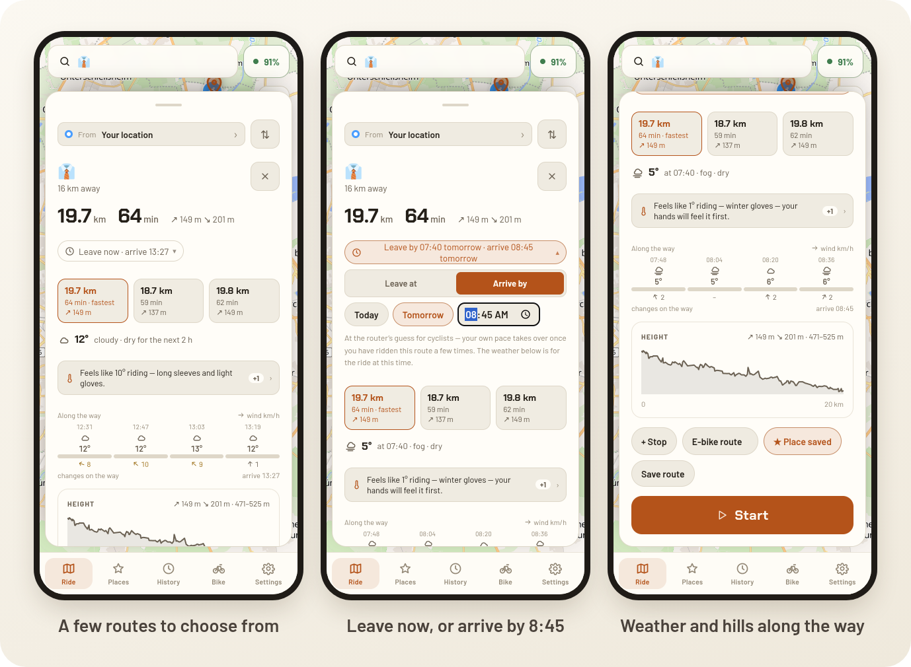
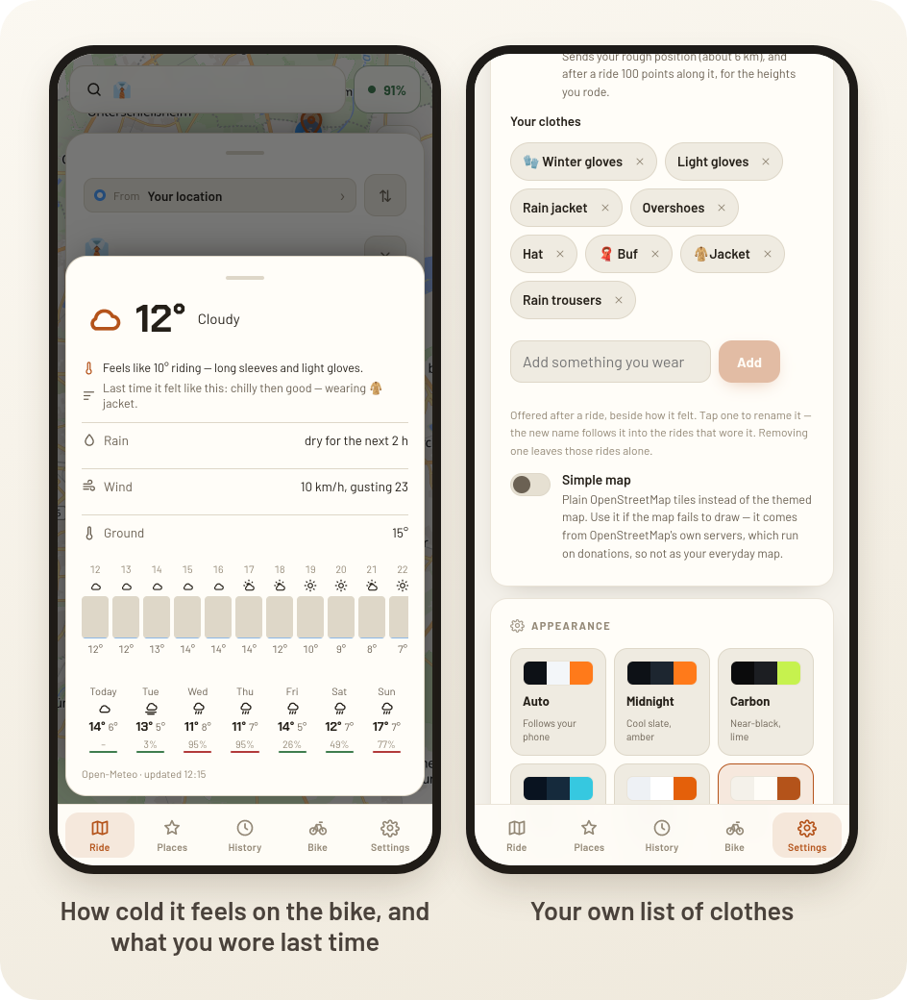
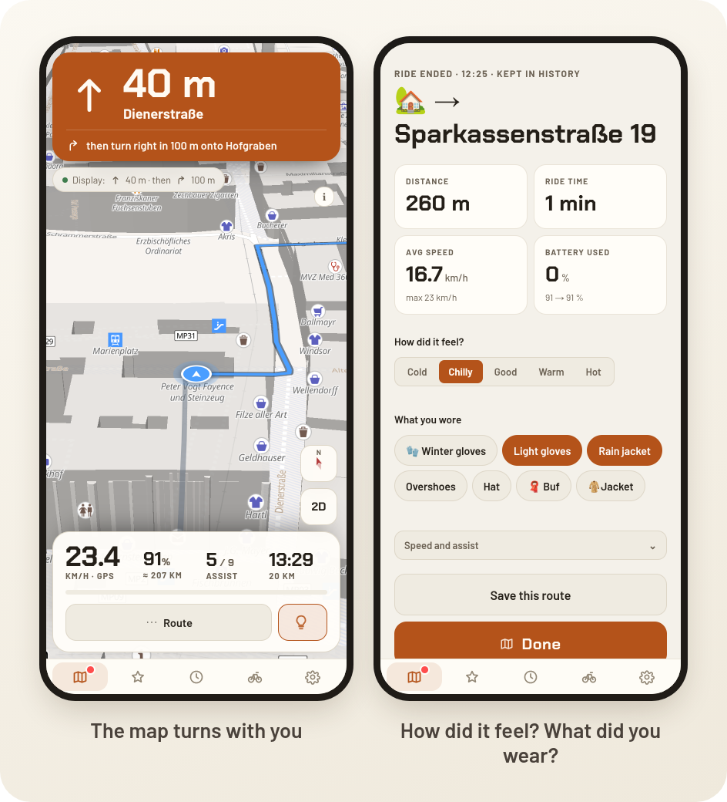
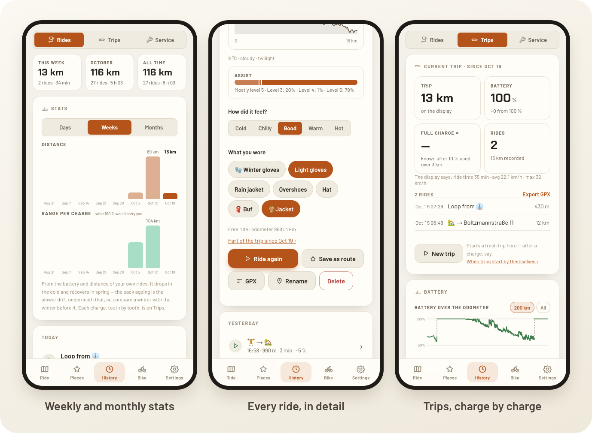
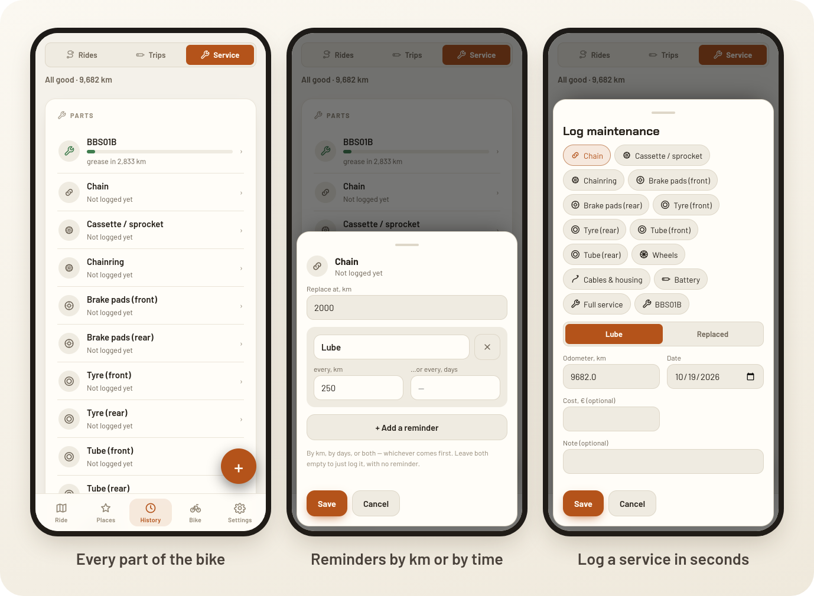
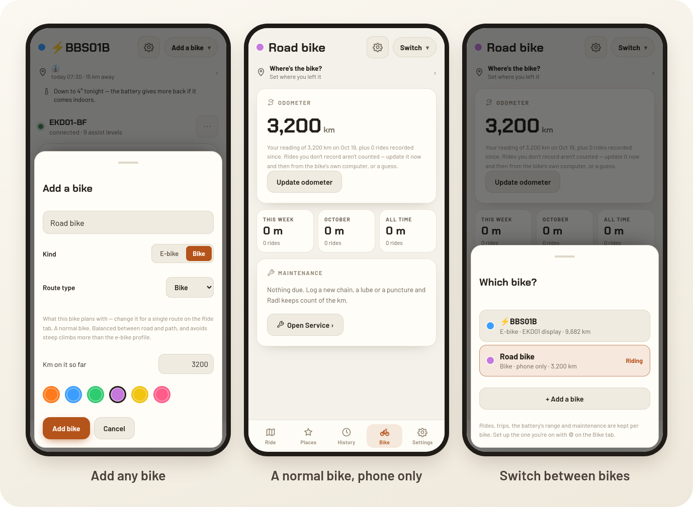
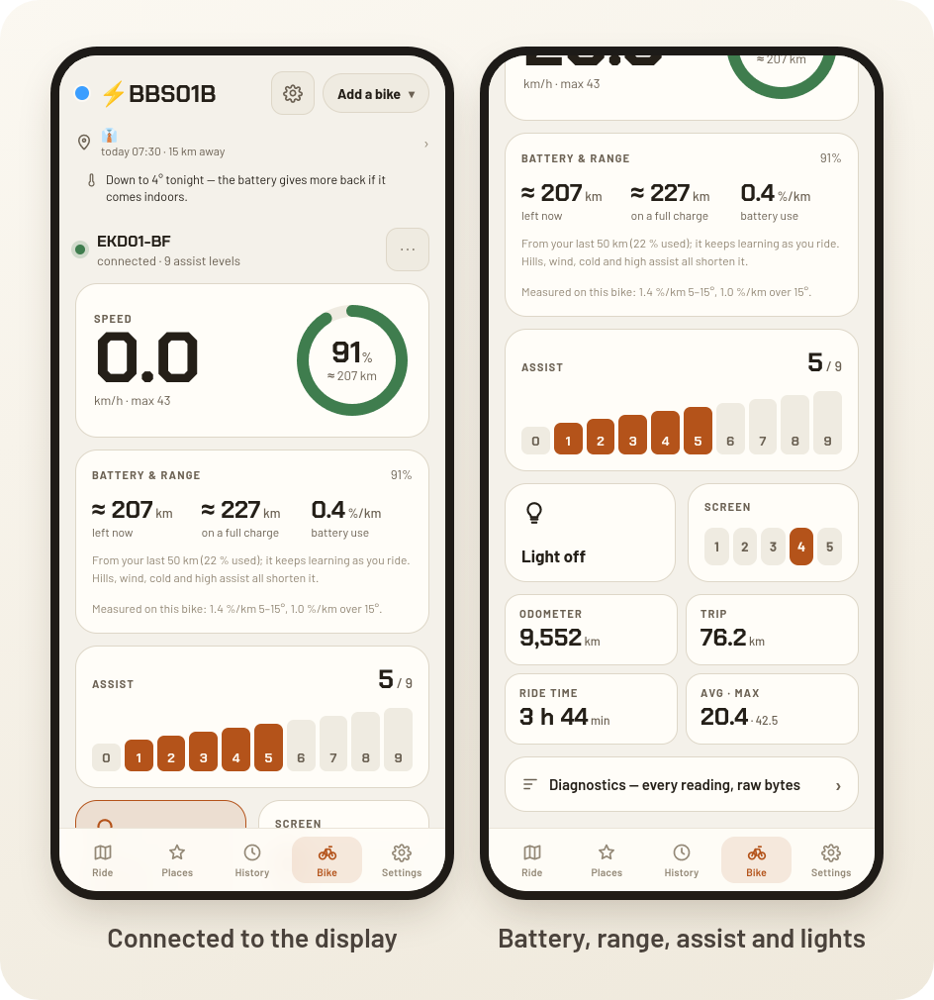
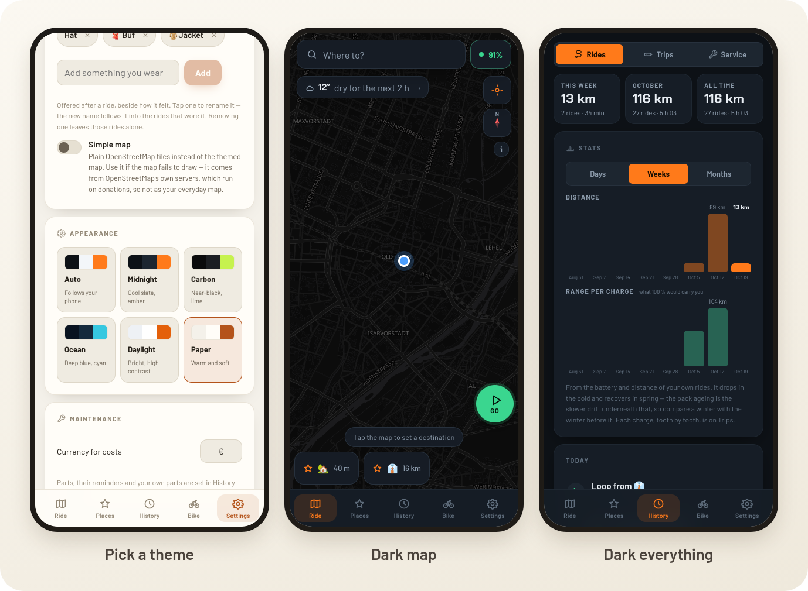



I ride my bike almost every day in Munich, and I kept juggling apps: one for directions, one to record the ride, a note on my phone to remember when I last oiled the chain, and a weather app to decide which jacket to take.

So I built **Radl** (Bavarian for "bike"): one companion app for the daily commute by bike.

It works with **any bike**. All you need is your phone. And if your e-bike has the right display, Radl can show the directions right there on the handlebars too.

{}
**Radl is live!** It is free, and you can try it right now at **[radl.marcb.pro](https://radl.marcb.pro)**. Open it on your phone and add it to your home screen. [How to get started ↓](#try-it)
{}

## The two-minute tour



*🔊 Sound on: narrated, with original background music. Narration voice by [ElevenLabs](https://elevenlabs.io).*

## Plan a ride

Pick where you want to go and Radl gives you a few routes to choose from, with the distance, the time and how much climbing there is. You can leave now, or tell it when you need to arrive and it tells you when to leave.

## Dress for the weather

This is the feature I use the most. Radl looks at the weather along your route and works out how cold it really feels **on the bike**, with the wind of riding included, and then tells you what to wear.

It also remembers how past rides felt, so it can say things like "last time it felt like this: chilly, wearing a jacket". You keep your own list of clothes.

## Ride

Once you are riding, you get turn-by-turn directions with the street names, and the map turns with you, just like Google Maps.

When you arrive, Radl asks how it felt (cold, chilly, good, warm or hot) and what you wore. That is what makes the clothing advice better over time.

## Your rides

Every ride is saved: where you went, how fast, the hills and the weather. The stats show how much you ride each day, week or month. On an e-bike, rides are also grouped into trips, from one charge to the next, so you learn how far you really get on a battery.

## Keep the bike happy

Radl counts the kilometres on every part of the bike (chain, brake pads, tyres…) and reminds you when something is due, either after so many kilometres or after so much time. Logging an oiled chain takes two taps.

## Works with any bike

You can add as many bikes as you like. A normal bike just uses your phone: GPS for the speed and distance, and Radl keeps count of the kilometres. No extra hardware needed.

## Bonus: directions on my e-bike display

My own bike is an e-bike, and its little handlebar display can show directions: an arrow and how far away the next turn is. The official app only does this if you pay for it.

When I looked into it, it turned out the display does not do any of the work. It has no GPS and no map. It just shows whatever the phone sends it over Bluetooth. So once I figured out how to talk to it, Radl could send it the next turn every second, for free.

And since Radl was already talking to the display, it now also shows the battery and how far it will still take you, and lets me change the assist level and the lights from my phone.

(For the curious: it is the EKD01 display that comes with Bafang motors.)

## Make it yours

There are a few themes to pick from, light and dark.

## How it is built

Radl is a web app that you install on your phone like a normal app. It works offline once installed. The maps come from [OpenStreetMap](https://www.openstreetmap.org/), the routes from [OpenRouteService](https://openrouteservice.org/) and the weather from [Open-Meteo](https://open-meteo.com/).

## Try it

Radl is live and free at **[radl.marcb.pro](https://radl.marcb.pro)**. To get started:

1. **Open [radl.marcb.pro](https://radl.marcb.pro) on your phone** and add it to your home screen (in your browser's menu: *Add to Home screen* or *Install app*). From then on it opens like any other app, even offline.
2. **Follow the short tour.** It shows you around the app in a minute.
3. **Get your free routing key.** Routes and address search use [OpenRouteService](https://openrouteservice.org/), so the tour asks you to make a free account at [account.heigit.org](https://account.heigit.org/) and paste your key. It takes two minutes, and it means the app stays free for everyone.
4. **Go for a ride!**

Have an e-bike with the EKD01 display? Connect it from the Bike tab. This part needs Chrome on Android, because iPhones do not let web apps use Bluetooth yet.

It is a side project, so if something breaks or you have an idea, [let me know](/#contact). I would love to hear how you use it.

> Radl is not affiliated with, or endorsed by, the display manufacturer or its official app.
